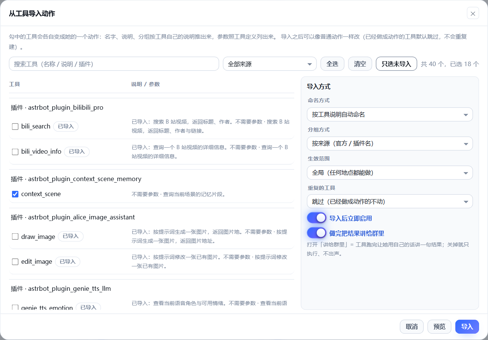
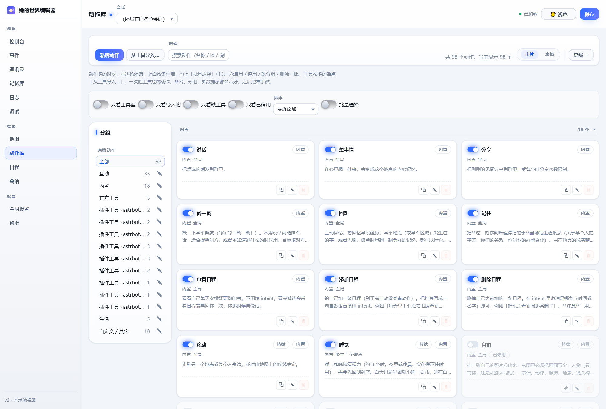

  

<h1 align="center">她的世界 HW</h1>

  <b>给 Bot 一个私有空间、一套生活节奏，再加一把随手就能用的工具。</b>

  
  
  

---

她有地图、动作、日程、情绪和记忆：会自己走动、做饭、发呆、翻旧账，也会主动找你说话。
需要动手的时候，你装过的插件工具可以直接变成"她会的手艺"——生图、搜新闻、发表情包、发语音都算。

她不是换个皮肤的回答机器，而是一台跑在后台、有状态、会积累经历的小型生活模拟器。

> **这个仓库是什么？**
> 它是 [`astrbot_plugin_virtual_world`](https://github.com/exneverbur/astrbot_plugin_virtual_world)（作者 exneverbur）的二次开发版，
> 从 v2.2.0 起换名成 **她的世界 HW**，并重点加强了「工具一键导入成动作」「动作库管理」「与其它插件的配合」。
> 原版的设计与实现是这个项目的底子，欢迎也给原仓库点个 star。

## 这个版本做了什么

| 方向 | 说明 |
| --- | --- |
| **换名与隔离** | 插件名、指令、数据目录、日志前缀、前端缓存键全部改成 `她的世界 HW` / `/hw`，和原插件互不干扰（建议只留一个启用）。 |
| **工具一键导入** | 动作库里多了「从工具导入…」：勾一个、勾几个或全选，工具自动变成动作，名字、说明、分组、参数提示一次带好，之后照常手改。 |
| **动作多了也不乱** | 动作库支持筛选（工具型 / 导入的 / 缺工具的 / 已停用）、排序、分组标题与批量启用 / 停用 / 改分组 / 删除。 |
| **和别的插件配合** | 表情包图片、TTS 语音这类由回复钩子产出的内容不再被吞掉；世界树注入的设定与临时模型切换也会认；日程工具可以一键从宿主工具列表里摘掉。 |
| **换过来不丢数据** | 第一次启动时自动把原插件的数据目录整份搬过来（只搬一次、不覆盖），地图 / 动作 / 日程 / 记忆 / 日志都在。 |

## 三十秒了解

**她有的**

- 一张两层地图：**区域**（家中 / 商业街 / 学校 / 公园 / 海边）→ **地点**（客厅 / 书房 / 卧室 / 窗边…），走过去要花时间，地点决定她能做什么。
- 一套动作库：模板文案 / 大模型现场生成 / 调用工具，三种层级随你挑。
- 按时间触发的日程：早上伸懒腰、傍晚做饭、睡前回卧室，地点不对她会自己走过去。
- 会变的数值：精力 / 孤独感 / 好奇心 / 心潮 / 效价 / 无聊 / 欲求，真的驱动她的行为。
- 按人存的通讯录与记忆：谁是谁、什么关系、好感多少、上次在这儿聊过什么。
- 会自己长起来的「心事」和「经历」：她心里挂着一件事的时候，你聊别的也看得出来。

**她不是**

- 不是换皮回答机：她的回复由插件自己组装提示词、自己调模型、自己执行动作。
- 不是指令机器人：工具在她这儿不是"用户触发的服务"，而是"她自己会的本事"。

## 一键把工具变成她的动作

原版里给每个工具建动作要一个个手点，工具上百个时非常费时间。现在动作库右上角有 **「从工具导入…」**：

一次做完这些事：

1. **选工具**：搜索、按来源（官方 / 具体插件）筛选、`全选` / `清空` / `只选未导入`，也可以只勾一两个。
2. **自动填好一切**：
   - 动作名：优先取工具说明的第一句（「搜索最近一天的新闻」），不够就退回工具名；
   - 说明：沿用工具作者写的那份说明；
   - 分组：默认按来源分（`官方工具` / `插件工具 · 某个插件`），也可以统一归到一个分组；
   - 参数：按工具的 JSON Schema 自动列出参数名 / 类型 / 是否必填 / 说明，运行时由辅助模型补全，不用手写；
   - 生效范围：可以全局，也可以只挂在指定地点（比如"只有在书房才能上网"）。
3. **可选的智能命名**：把「命名方式」换成"让内容生成模型起名"，它会按她的人设把工具起成"她会说出口的那件事"（例如把 `magpie_search_meme` 起成「挑表情包」），失败会自动退回规则命名。
4. **预览再导入**：点 `预览` 会列出每个动作的名字、分组、工具、参数与说明，以及"哪些工具被跳过、为什么"。
5. **导入后可改**：导入的动作和普通动作完全一样，可以继续改名字、改说明、加固定参数、绑到别的地点、停用或删除。

几点值得知道：

- **已经导入过的工具默认跳过**，不会重复建动作；想用最新说明覆盖旧动作，把「重复的工具」换成"覆盖已有的那个动作"。
- 「直接把消息发到会话」的工具（例如 `send_message_to_user`）默认不导入：调用它会绕过回复管线，分段、表情包、发送前钩子都会失效。
- 导入是**直接写盘并热加载**的，不用再点右上角保存；如果动作库里还有没保存的改动，编辑器会先问一句。
- 想让导入的动作闷头干活不说话，把「做完把结果讲给群里」关掉即可。
- 参数是"照工具定义列出来"的，不需要你手写；想钉死某个参数（例如天气工具的 `city`），在动作编辑抽屉里点那个参数的「固定」。

## 动作多了也不乱

- **左边按组筛**：内置 / 互动 / 表达 / 生活 / 自定义，以及每个插件带来的动作各占一组，后面跟着数量。
- **上面按条件筛**：只看工具型、只看导入的、只看缺工具（工具已经卸载了）、只看已停用。
- **分组标题**：卡片按分组分段显示，点标题可以整段收起。
- **批量选择**：勾上「批量选择」，卡片和表格都能多选，然后一次启用 / 停用 / 改分组 / 删除一批动作。
- **表格视图**：适合横向核对"范围 / 时长 / 工具 / 状态"。

## 她是怎么转起来的

> 事件驱动记忆，记忆驱动关系，关系驱动情绪，情绪驱动决策，决策驱动事件。

她遇上事 → 事情变成记忆 → 记忆改变她对某个人的关系与印象 → 关系和数值决定她此刻的情绪 →
情绪又决定她下一轮想做什么 → 做出的事再来一件。功能之间互相喂养，而不是各管一段。

## 和别的插件一起用

她接管回复时是自己调模型、自己发送的，AstrBot 原来那条管线不会跑，所以插件会把该补的钩子补上。
下面三个插件是**专门适配过**的：

| 插件 | 适配方式 |
| --- | --- |
| [**meme_magpie**（表情神偷）](https://github.com/Whereis-Alice/astrbot_plugin_meme_magpie) | 它挂在「发送前」钩子上贴表情包图片。接管时我们会把这个钩子补发一遍，并且**把图片原样发出去**（以前只捞文本，图片会被丢掉）。它的搜索 / 发送 / 收录三个工具也能用「从工具导入…」挂成她的动作。 |
| [**genie_tts_llm**](https://github.com/Whereis-Alice/astrbot_plugin_genie_tts_llm) | 它在「模型响应后」把回复换成一段语音。接管时我们同样补发这个钩子，并识别出"整条回复已经被换成语音"，于是**只发语音、不再把同一句话念两遍**；「文字 + 语音」模式两者都会发。它的 `genie_tts_speak` 工具也能导入成动作。 |
| [**worldtree_lore**（世界树）](https://github.com/Whereis-Alice/astrbot_plugin_worldtree_lore) | 它把设定写进 `system_prompt` 或 `extra_user_content_parts`，还会临时指定模型。接管时这两样都会跟着走：设定进她的提示词，临时模型也用于这一轮回复；它自己的工具同样可以导入成动作。 |
| [**helper_tools**（助手工具集）](https://github.com/Whereis-Alice/astrbot_plugin_helper_tools) | **环境感知**（时间 / 节假日 / 农历 / 节气 / 平台 / 群名 / 发言人资料 / Bot 群身份）挂在 `on_llm_request` 上、写进 `extra_user_content_parts`，接管时会被原样带进「其他插件提供的上下文」；它的引用媒体标注、戳一戳上下文同理。老版本 AstrBot 上这些内容会退化成拼在用户那句话后面，本插件会把它们摘出来单独带，不会误当成群友说的话。它注册的 LLM 工具（推特 / 网页浏览 / QQ 信息 / 今日小猪 / 语音…）都能在动作库里一键导入；被它在面板上关掉的模块不会出现在可导入列表里。 |

一句话：**这些插件不需要为她的世界改任何代码**，装好就能一起用。

### 别的插件给的上下文，会怎么进她的提示词

她接管回复时是自己拼提示词、自己发请求的，所以下面这些通道都做了显式对接（记忆插件、
上下文插件、世界书、环境感知都用得上）。**接管时会故意排在所有插件后面**，
就是为了让它们先写完、我们再一起带走：

| 别的插件从哪儿写 | 她这一轮会看到什么 |
| --- | --- |
| `req.system_prompt` | 原样进「其他插件提供的上下文」。AstrBot 自己的「人格设定」块会被**精确**摘掉（她的人设由插件这边给），紧跟其后的插件内容不会跟着被删 |
| `req.extra_user_content_parts` | 同上（世界树的设定、helper_tools 的环境感知走这条） |
| `req.contexts`（宿主的对话历史） | 原样作为 `contexts` 传给她这一轮的主模型调用 |
| `req.prompt` 尾巴上拼的临时信息 | `[环境感知]` 这类按边界摘出来单独带，正文保持干净（老版本 AstrBot 的降级路径） |
| `req.image_urls` | 和这一条消息自己带的图一起去重、一起编号，不会少看一张 |
| `event.set_extra(...)` | 认明确约定的键：意图路由的事前判定、世界树的临时模型 |
| 别的插件先 `stop_event()` | 她直接不接管，那条消息按对方的意思走 |

两个边界要说清：她自己的后台行为（决定去哪、走日程、主动搭话）不经过别的插件的
`on_llm_request`，那些调用用的是她自己提示词里的时间 / 位置 / 状态；
语音消息目前只会在记录里标一句「这是一段语音消息」，内容转写要靠 AstrBot 那边装语音转文字。

### 会不会影响我其它的插件和功能？

按"最容易被误会"的几件事逐条说清：

| 你担心的 | 实际情况 | 想关掉怎么办 |
| --- | --- | --- |
| 抢走所有大模型请求 | 只接管**白名单会话**里真正走到大模型的那条消息；指令、被别的插件先回掉的消息、没走到大模型的消息都不碰。接管失败时她选择安静，**不会**换成主人格的腔调回答。 | 会话页把会话移出白名单，或全局关掉插件。 |
| 别的插件收不到回复 | 接管后会补发「模型响应后 / 发送前 / 等模型 / 用工具 / 用完工具 / 发完消息」这些钩子，好感度、统计、表情包、TTS 这类插件照常工作。 | 配置里关掉「接管回复也过其他插件的钩子」。 |
| 大模型看不到我的工具 | 反过来：为了省 token，她这一轮只会看到"当前地点允许的工具"。按地点裁剪可以整体关掉。 | 世界配置里关掉「按地点裁剪 AstrBot 工具集」。 |
| 我的工具列表被她塞满 | 她只在动作里挂工具，不会往你的工具列表里加东西；三个日程工具（`hw_schedule_*`，给主人格用的）可以一键从工具管理器里摘掉。 | 配置里关掉「把日程工具交给主人格」。 |
| 睡觉时别的插件不响应 | 她睡着时默认只挡**群里没 @ 她**的消息（这是"别吵醒她"的设计），@ 她、私聊、指令一律放行。 | 世界配置的睡觉设置里把「挡下消息」关掉，或把范围改成只挡 @ 她的。 |

## 快速开始

1. **装插件**：在 AstrBot 插件市场安装，或把仓库放进 `data/plugins/`。只用 AstrBot 自带依赖 + Python 标准库。
2. **加会话**：在群里发 `/hw session add`（或稍后在编辑器「会话」页添加）。只有白名单里的群 / 私聊才会启用。
3. **打开编辑器**：AstrBot 面板 → 插件 → 她的世界 HW → 「她的世界编辑器」。
4. **跑一遍设置向导**：第一次进来自动弹窗，六步带你配完会话、她是谁、用哪个模型、手感参数、记忆与画像。
5. **发条消息试试**：`/hw status` 看她现在在干嘛；编辑器「控制台」页可以手动推进 tick，几分钟就能把一天过完。
6. **挂工具**：动作库 →「从工具导入…」→ 勾上要用的工具 → 导入。

> 编辑器是左侧分组导航（观察 / 编辑 / 配置），右上角有深色 / 浅色主题开关（会记住你的选择）。
> 改完配置点右上角**保存**即可热重载，不用重启 AstrBot。

## 常用指令

指令前缀是 `hw`，同时认「她的世界」和 `herworld` 两个别名（写 `/hw`、`！hw` 还是去掉唤醒前缀的 `hw`，取决于你的唤醒前缀设置）。

| 指令 | 说明 |
| --- | --- |
| `/hw status` | 她现在在哪、在做什么、心情与各项数值 |
| `/hw memory` | 看看她记得你什么 |
| `/hw recall <话题>` | 让她回忆某个话题 |
| `/hw forget me [话题]` | 让她忘记关于你的记忆 |
| `/hw event <一句话>` | 给她安排一件会发生的事 |
| `/hw schedule` | 查看全部日程 |
| `/hw session add` | 把当前会话加进白名单 |
| `/hw help` | 完整指令表（含管理员与调试指令） |

管理指令（`ability` / `thread` / `nickname` / `reload` / `reset` / `restore-default` / `debug` 等）见
[文档](docs/integration.md)。

## 页面导览

| 页面 | 看什么 / 改什么 | 截图 |
| --- | --- | --- |
| 控制台 | 她在哪、在做什么、数值曲线、当前计划 | [status.png](docs/images/status.png) |
| 事件 | 投递一件事、看她的处理过程与能力值 | [events.png](docs/images/events.png) |
| 地图 | 区域 → 地点、连线耗时、地点氛围 | [world_map.png](docs/images/world_map.png) |
| 动作库 | 动作编辑、筛选、批量管理、从工具导入 | [actions.png](docs/images/actions-manage.png) |
| 日程 | 到点自动执行的动作链 | [schedules.png](docs/images/schedules.png) |
| 通讯录 | 她认识的人、关系、好感变化 | [contacts.png](docs/images/contacts.png) |
| 记忆库 | 按人 / 地点 / 场景存的记忆 | [memories.png](docs/images/memories.png) |
| 日志 / 调试 | 她的每一次决定，以及上一轮真实请求 | [logs.png](docs/images/logs.png) · [debug.png](docs/images/debug.png) |

## 从原插件换过来

装了本插件就不用再启用 `astrbot_plugin_virtual_world` 了。第一次启动时如果本插件的数据目录是空的，
它会自动把原插件数据目录里的 `world.json` / `schedules.json` / `sessions.json` / `state.db` 与历史快照
整份复制过来（只复制一次，不覆盖任何已有文件）。日志里会写明搬了哪些文件。

两点提醒：

- **不要两个插件同时启用**：两边会各写各的库，谁改的都不会进对方那份。
- 插件的**模型选择等面板配置**不会跟着搬（那是 AstrBot 自己的配置项），照着自己重选一次即可。
- 想关掉自动搬运：面板配置里关掉「自动接管原插件的数据」，或设环境变量 `HER_WORLD_MIGRATE_FROM=none`。

## 常见问题

**她怎么不回我？**
先确认这个会话加进白名单了，再看「全局设置 → 说话与决策」里的回复概率和每小时额度。群里没被点到的时候，她本来就多数时候不接话。

**要花很多 token 吗？**
主模型只管"她该开口的时候"，决策、整理、检索这些交给便宜的辅助模型，而且都有每小时额度；工具参数也只在用到时才补全。

**工具型动作没反应？**
打开动作库的「只看缺工具」筛一下：工具被卸载、改名之后动作会失效。日志页会写明是哪个动作、为什么跳过。

**出问题了怎么查？**
编辑器「日志」页有她的每一次决定和动作；「调试」页能预览接管请求（上一轮实际发出去的那份原文）、自主提示词和配置备份，还能把过程回显到群里。

更多问题见[常见问题](docs/faq.md)。

## 文档

- **[文档目录](docs/README.md)** — 按「上手 → 世界 → 她怎么想 → 她怎么行动 → 她记得什么 → 排查」分类的全部入口。
- [动作与工具](docs/actions.md) — 动作字段、工具调用、参数补全、联网检索的完整说明。
- [详细说明 GUIDE](docs/GUIDE.md) — 机制细节、数值系统、跨插件联动、存储结构。
- [更新日志](CHANGELOG.md)。

## 致谢与来源

- 原项目：[exneverbur/astrbot_plugin_virtual_world](https://github.com/exneverbur/astrbot_plugin_virtual_world)。
  世界、动作、日程、记忆、事件这套核心设计来自原作者，本仓库在它的 v2.1.8 上继续开发。
- 适配的三个插件由 [Whereis-Alice](https://github.com/Whereis-Alice) 维护：表情神偷、世界树、Genie TTS。
- 上游仓库没有附带开源许可证文件，本仓库沿用同一份代码并保留来源说明（见 [NOTICE.md](NOTICE.md)）；
  如需商用或再分发，请先与原作者确认授权。

## 欢迎来玩

原项目的交流群：Q 群 **774141179**（讨论她的世界系列配置）。
